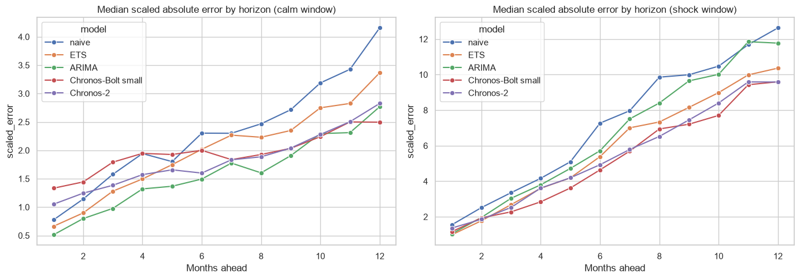
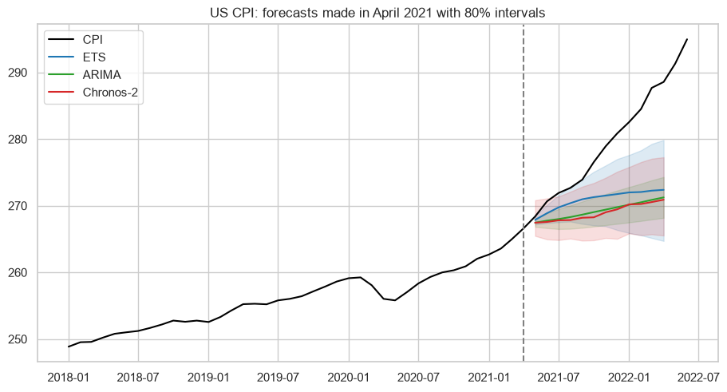

# Foundation models for time series: Chronos vs ETS and ARIMA on macro data

Time series foundation models are pretrained on millions of series and used zero-shot, without training. Are they better than the classical models for the monthly macro series that banks and asset managers forecast? This project compares the following models with the same rolling backtest (12 months ahead, the last 30 years of history at each origin):
- **Naive** (random walk), the benchmark.
- **ETS** (damped trend) and **ARIMA** (order chosen by AIC), fitted at each origin.
- **Chronos-Bolt small** and **Chronos-2** (Amazon), zero-shot.

**Data:** 16 FRED series covering prices, labour, activity, rates and the exchange rate (US, euro area and France).

**Windows:**
- a calm period: 9 origins, forecasts for 2023-2026;
- the inflation shock: 5 origins in 2021.

## Results
| | Calm: relative MASE | Calm: WQL | Calm: 80% coverage | Shock: relative MASE | Shock: median WQL | Shock: 80% coverage |
|---|---|---|---|---|---|---|
| Naive | 1.00 | 0.035 | 71% | 1.00 | 0.047 | 50% |
| ETS | 0.84 | 0.034 | 93% | 0.81 | 0.036 | 60% |
| ARIMA | **0.67** | 0.032 | 94% | 0.89 | 0.037 | 52% |
| Chronos-Bolt small | 0.84 | 0.030 | 95% | **0.75** | **0.034** | **67%** |
| Chronos-2 | 0.79 | **0.029** | 89% | 0.78 | 0.035 | 63% |

- **Calm times:**
  - ARIMA is the best point forecast and wins in 7 of 16 series.
  - Chronos is the worst at 1 to 3 months ahead.
  - Chronos-2 has the lowest quantile loss.
- **Inflation shock:**
  - Chronos is the most robust.
  - ARIMA, the best in calm times, is the worst of the four models.
  - Every interval was too narrow: in April 2021 none of the models saw the CPI of 2022.
- **Cost:**
  - Chronos makes the 224 forecasts in 2 to 9 seconds on a laptop CPU, with no fitting.
  - The ARIMA search takes more than 3 minutes.
- **Conclusion:** Chronos is a strong zero-shot baseline and robust to changes of regime, but it does not replace a well specified classical model. Both belong in the benchmark.




## How to run
```
pip install -r requirements.txt
python download_fred.py
jupyter notebook chronos_benchmark.ipynb      # the forecasts are saved in data/forecasts
```

---
Alejandro Lezcano Osorio | Rennes School of Business (MSc in Financial Data Intelligence) and Universidad EIA
